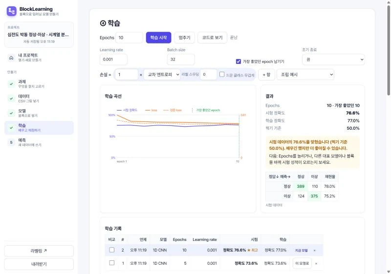

# BlockLearning

파이썬·딥러닝 코드를 몰라도 브라우저 화면에서 **블록(층)을 선으로 이어** 딥러닝 모델을 만들고, 학습하고, 결과를 보는 도구입니다.
센서·설비·심전도 같은 시계열, 표 데이터, 이미지(흑백·컬러)를 다룹니다.

### 👉 [사용 설명서 (설치부터 학습까지)](https://jeon-stat.github.io/blocklearning/guide.html)

설치, GPU 설정, GPU 서버에서 쓰기, 단계별 사용법, 문제 해결을 화면과 함께 정리했습니다.



> 교육·실험용 도구입니다. 학습 결과를 의료 진단이나 제조 판정 같은 실제 결정에 그대로 쓰지 마세요.

## 바로 써 보기

설치 없이 브라우저에서: **https://jeon-stat.github.io/blocklearning/**

계산은 모두 그 브라우저 안에서 하고, 고른 데이터는 PC 밖으로 나가지 않습니다. 처음 열 때 10~20초 걸립니다.

## 내 PC에 설치하기

Python 3.10 이상이 필요합니다. Anaconda Prompt나 PowerShell(Mac은 터미널)에서:

```bash
pip install blocklearning      # 처음 한 번
python -m blocklearning        # 실행: 브라우저가 열립니다 (끝내려면 Ctrl+C)
```

- **NVIDIA GPU로 학습하려면** 먼저 GPU용 PyTorch를 까세요. 그냥 설치하면 Windows에서는 CPU용이 깔립니다.
  `pip install torch --index-url https://download.pytorch.org/whl/cu126` ([자세히](https://jeon-stat.github.io/blocklearning/guide.html#gpu))
- **새 버전으로:** `pip install -U blocklearning`
- **GPU 서버에서:** 서버에 SSH로 들어가 위처럼 실행하면, 내 PC 브라우저로 여는 방법이 명령창에 나옵니다 ([자세히](https://jeon-stat.github.io/blocklearning/guide.html#server))

## 쓰는 순서

| 단계 | 하는 일 |
|---|---|
| 내 프로젝트 | 첫 화면. 새 프로젝트를 시작하거나 저장된 프로젝트를 엽니다 (자동 저장) |
| ① 과제 | 분류·회귀·이상 탐지 등 할 일과 데이터 종류를 고르면 대표 모델을 추천 |
| ② 데이터 | 예시 데이터를 누르거나, CSV·시계열 폴더·이미지 폴더를 고름 |
| ③ 모델 | 대표 모델로 시작하거나, 블록을 끌어 이어 붙여 직접 만듦 |
| ④ 학습 | 학습 곡선·성적·틀린 샘플을 보고, 학습 기록끼리 비교 |
| ⑤ 예측 | 학습한 모델로 새 데이터를 예측하고 CSV로 받음 |

학습한 모델은 PyTorch·TensorFlow 코드나 TorchScript(`.pt`) 파일로 내보낼 수 있습니다.

큰 작업용으로 AdamW·SGD, 학습률 스케줄(cosine·warmup), gradient clipping, 혼합 정밀도(AMP), 이어서 학습, 컬러·224×224 그림, torchvision 사전학습 CNN(ResNet·EfficientNet·ConvNeXt·ViT, 설치형)을 씁니다 ([자세히](https://jeon-stat.github.io/blocklearning/guide.html#heavy)).

## 할 수 있는 과제와 예시 데이터

모두 공개된 실제 데이터입니다 (출처·라이선스는 `src/blocklearning/data/*.SOURCE.txt`).

| 과제 | 예시 데이터 | 대표 모델 |
|---|---|---|
| 분류 · 시계열 | 베어링 진동 결함 ([오타와대](https://doi.org/10.17632/v43hmbwxpm.2)) / 심전도 박동 정상·이상 ([MIT-BIH](https://physionet.org/content/mitdb/1.0.0/), 진단용 아님) | 1D CNN, ResNet1D, InceptionTime, TCN, LSTM, Transformer |
| 분류 · 표 | 강판 결함 7종 ([UCI](https://archive.ics.uci.edu/dataset/198)) | MLP, FT-Transformer식 |
| 분류 · 이미지 | 강판 표면 양호·불량 ([SteelBlastQC](https://doi.org/10.34894/EKZNN0)) / 흉부 X-ray ([PneumoniaMNIST](https://medmnist.com/), 진단용 아님) / 손글씨 숫자 ([UCI](https://archive.ics.uci.edu/dataset/80)) | 작은 CNN, 작은 ResNet, 전이 학습 (MobileNetV3), ViT |
| 회귀 | 유압 신호 → 밸브 상태 % ([UCI](https://archive.ics.uci.edu/dataset/447)) / 콘크리트 배합 → 강도 ([UCI](https://archive.ics.uci.edu/dataset/165)) | ResNet1D, 1D CNN, MLP |
| 객체 탐지 · 이미지 | PCB 결함 위치 ([PCB-Defect](https://doi.org/10.17632/vdj74sngvn.2)) | 작은·깊은 탐지 모델, 전이 학습 탐지 |
| 이상 탐지 | 베어링 진동 · 유압 시스템 · 강판 표면 · 흉부 X-ray (정상만 학습) | 오토인코더, 사전학습 특징 + 정상과의 거리 |
| 예측 · 시계열 | 철강 공장 전력 사용량 다음 하루 ([UCI](https://archive.ics.uci.edu/dataset/851)) | 선형 (DLinear식), MLP, 1D CNN, LSTM, Transformer |
| 구간 분할 · 시계열 | 검사 기계 전류·압력의 시점마다 공정 단계 ([Mendeley](https://doi.org/10.17632/ypzswhhzh9.3)) | TCN, U-Net식, 양방향 GRU |
| 여러 정답 · 표 | 유압 시스템 상태(분류)와 밸브 %·압력(숫자)을 한 번에 | MLP (몸통 함께 쓰기) |
| 생성 · 이미지·시계열 | 손글씨 숫자 새 그림 / 심전도 새 박동 (진단용 아님) | VAE (Conv), VAE (Dense) |

## 더 보기

- [사용 설명서](https://jeon-stat.github.io/blocklearning/guide.html): 설치부터 사용, 문제 해결까지
- [개발·구조 문서](docs/DEVELOPMENT.md): 웹 버전 구조, 세부 기능, 개발·시험·배포
- [보안](SECURITY.md) · [개인정보처리방침](privacy.html) · [PyPI](https://pypi.org/project/blocklearning/)

MIT License
